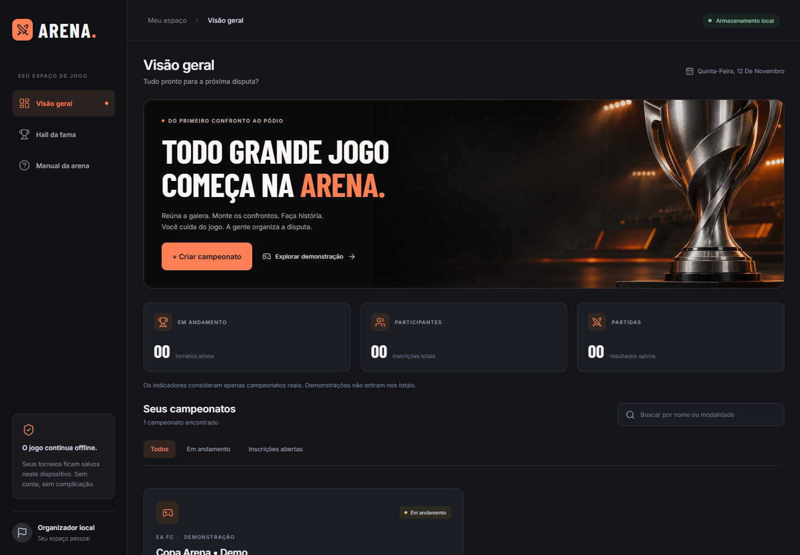
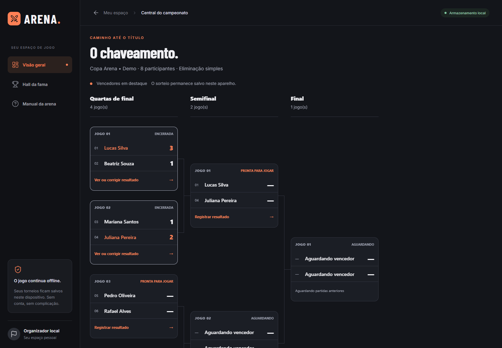
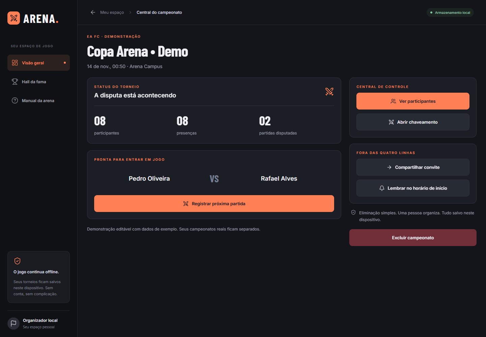
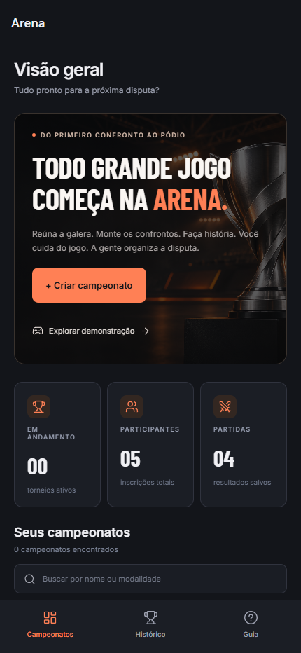
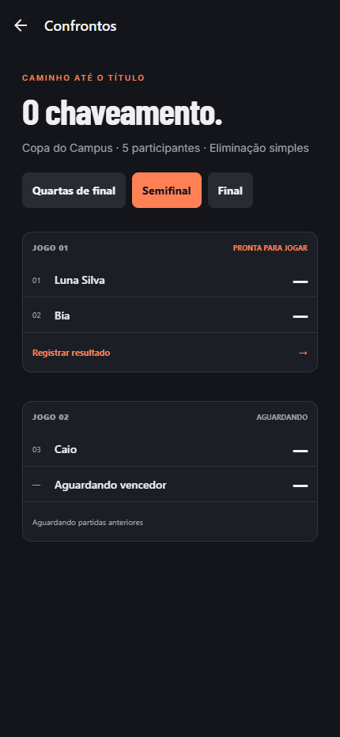
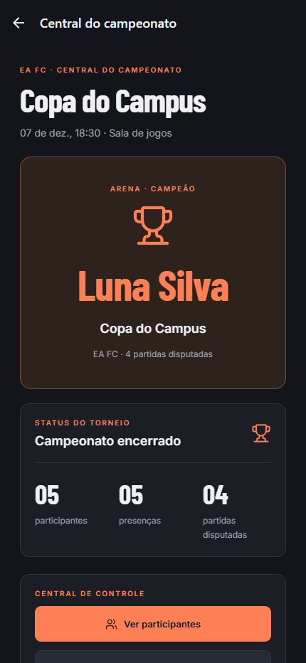

# Arena

**Seu jogo. Sua arena.** Organizador mobile de campeonatos presenciais entre amigos, criado do zero com React Native, Expo Router e TypeScript para a avaliação de Mobile.

Repositório: [EznRB/arena-campeonatos](https://github.com/EznRB/arena-campeonatos).

Aplicação publicada: [arena-campeonatos.vercel.app](https://arena-campeonatos.vercel.app).

Uma pessoa organiza o torneio no próprio aparelho: cadastra participantes, confirma presenças, sorteia confrontos e registra resultados até o campeão. O fluxo principal funciona sem internet e sem conta.

## Galeria

### Interface reformulada em 11/11

Composição própria para desktop e adaptação mobile. Capturas reais, com campeonato demonstrativo identificado:



| Chaveamento completo | Central do campeonato |
|---|---|
|  |  |

[Criar campeonato](docs/images/v2-desktop-criar.png) · [Versão mobile](docs/images/v2-mobile-dashboard.png) · [Notas da reformulação](docs/REDESIGN.md).

Na tela inicial, **Explorar demonstração** cria uma cópia local de um torneio com oito jogadores e confrontos prontos para continuar. Dados demonstrativos não entram nos indicadores dos campeonatos reais.

Capturas reais da versão web executada em viewport de 430 × 932. São evidência do fluxo e da interface; não substituem prints e testes do Expo Go em dispositivo físico.

| Início | Confrontos | Campeão |
|---|---|---|
|  |  |  |

Mais telas: [participantes](docs/images/02-participantes.png), [cartão QR](docs/images/03-cartao-qr.png), [placar](docs/images/05-resultado.png) e [histórico](docs/images/07-historico.png).

## Executar

### Pré-requisitos

- Node.js **24 LTS**, recomendado para o Expo SDK 58. A versão 25 instalada nesta máquina não atende aos engines do SDK. O projeto inclui `.nvmrc` e um iniciador PowerShell com alternativa automática usando Node 24.
- npm, computador e celular na mesma rede para Expo Go.
- Expo Go compatível com SDK 58. Consulte [a página oficial do Expo Go](https://expo.dev/go). Se a versão da loja for diferente, use a versão compatível para Android ou um development build; não atualize dependências individualmente para contornar incompatibilidade.

```powershell
cd "C:\Users\enzo\Desktop\dev mobile\arena"
npm ci
npx expo start
```

No Windows, também é possível executar:

```powershell
.\iniciar.ps1
```

O iniciador instala dependências se necessário e usa Node 24 quando a versão principal instalada é incompatível. Se a política de execução bloquear scripts, use os comandos npm acima com Node 24, ou:

```powershell
npm exec --yes --package=node@24 -- node node_modules/expo/bin/cli start
```

Leia o QR do Metro no Expo Go (Android) ou na câmera (iOS). No terminal, `w` abre a versão web. Problemas de rede: tente `npx expo start --tunnel` (pode solicitar instalação do adaptador de túnel). Android Studio e Xcode não são necessários para usar o Expo Go.

### Prévia web e verificações

```sh
npm test
npm run typecheck
npm run lint
npx expo-doctor
npx expo export --platform web
npm run preview
```

Prévia local: `http://127.0.0.1:4173`. Após iniciar a prévia, em outro terminal:

```sh
npm run test:e2e
```

O teste de interface usa `playwright-core` e Google Chrome instalado. No Windows, procura o caminho padrão de instalação. Em outro ambiente, informe `CHROME_PATH` com o executável do navegador. As capturas são regeneradas em `docs/images`. A prévia serve somente em localhost; não é um servidor de produção.

Exportar o bundle Android:

```sh
npx expo export --platform android --output-dir dist-android
```

Exportar bundle não produz um APK e não comprova funcionamento do hardware. Para um build instalável, configure sua conta Expo/EAS e identificadores próprios antes de distribuir.

## Fluxo de demonstração

1. Criar “Copa do Campus”, escolher modalidade, local e horário.
2. Adicionar cinco participantes para demonstrar avanços automáticos.
3. Abrir e compartilhar o cartão QR de uma inscrição. Em um segundo aparelho ou papel, apresentar o cartão para leitura no aparelho organizador. Confirmar os demais manualmente.
4. Iniciar o torneio. O sorteio é persistido e não muda ao reabrir.
5. Registrar as quatro partidas reais, passando pelas abas de rodadas. Em um empate, informar o vencedor do desempate.
6. Mostrar o campeão e compartilhar o card. Reabrir o app e conferir o histórico.
7. Em outro torneio com data futura, autorizar e agendar o lembrete local.

## Funcionalidades e regras

- Eliminação simples com 4–16 jogadores ou equipes representados por um nome.
- Nomes de participantes únicos no campeonato, ignorando maiúsculas/minúsculas.
- Check-in manual ou por QR; todos os inscritos precisam estar presentes para iniciar.
- Sorteio Fisher–Yates e chave na próxima potência de dois; byes apenas na primeira rodada.
- Placar inteiro entre 0 e 999. Empate exige escolha explícita do vencedor conforme a modalidade.
- Correção permitida enquanto nenhum confronto dependente tiver resultado. Alterar uma semifinal já usada em uma final disputada é bloqueado.
- Participantes podem ser adicionados/removidos antes do início; após o sorteio, a lista fica fechada.
- Histórico, busca, exclusão com confirmação e estados de loading/error/empty.

## Recursos nativos

| Recurso | Uso e comportamento alternativo |
|---|---|
| Câmera | Scanner de QR de inscrição; negativa de permissão mantém check-in manual. |
| Notificações locais | Lembrete no horário de início, com canal Android e pedido de permissão. Sem push remoto. |
| Compartilhamento | Cartão QR e campeão como imagem no mobile; convite como texto. Na web, cartão pode ser impresso e o campeão compartilhado como texto. |
| Haptics | Retorno tátil em ações concluídas; falta de suporte não cancela a operação. |
| AsyncStorage | Dados locais validados e escritos em fila; a interface publica a mudança depois da gravação. |

O QR não é credencial de segurança: identifica um participante no torneio daquele aparelho. Compartilhar convite ou cartão não sincroniza campeonatos entre dispositivos. Notificações dependem de autorização e configurações do sistema.

## Arquitetura

```text
src/
  app/                 Rotas e layouts do Expo Router
    (tabs)/            Campeonatos, histórico e guia
    tournament/        Central e campeão
    participants/      Cadastro e presenças
    bracket/           Rodadas e confrontos
    match/             Placar e desempate
    ticket/            Cartão QR
    scanner/           Câmera para check-in
  components/          Componentes visuais e listas reutilizáveis
  domain.ts            Regras puras, tipos e validação dos dados
  store.tsx            Contexto, hidratação e fila de persistência
  use-tournament.ts    Custom hook de seleção por rota
  native.ts            Notificações e haptics
tests/                 Testes de domínio
scripts/               Prévia SPA e teste real de interface
docs/                  Plano, rubrica, quatro pilares e capturas
output/pdf/            Documento acadêmico
```

Sem backend, chaves secretas ou variáveis de ambiente para o fluxo principal. Hooks usados: `useState`, `useEffect` com cleanup, `useRef`, `useCallback`, `useContext` e custom hooks. Listas usam `FlatList`. Componentes de texto usam `Text`.

## Dependências

As versões exatas estão em [package-lock.json](package-lock.json); as declaradas, em [package.json](package.json).

- **Base:** `expo`, `react`, `react-native`, `typescript`, `@types/react`.
- **Navegação:** `expo-router`, `expo-linking`, `expo-constants`, `react-native-screens`, `react-native-safe-area-context`.
- **Mobile:** `expo-camera`, `expo-crypto`, `expo-haptics`, `expo-notifications`, `expo-sharing`, `expo-status-bar`.
- **Persistência:** `@react-native-async-storage/async-storage`.
- **Cartões:** `react-native-qrcode-svg`, `react-native-svg`, `react-native-view-shot`.
- **Web:** `react-dom`, `react-native-web`.
- **Identidade visual:** `expo-font`, `@expo-google-fonts/inter`, `@expo-google-fonts/barlow-condensed`, `lucide-react-native`.
- **Qualidade:** `eslint`, `eslint-config-expo`, `playwright-core`; runner de testes nativo do Node.

## Evidências e limites

Consulte [VERIFICACAO.md](docs/VERIFICACAO.md) para resultados executados, limitações e avisos de dependências. O workflow `.github/workflows/ci.yml` executa as verificações a cada push; consulte o resultado remoto na aba Actions do repositório.

Os dados ficam neste dispositivo/navegador. Desinstalar, limpar dados do aplicativo ou armazenamento do navegador remove os campeonatos. O backup online é manual e opcional; depende da configuração Supabase descrita abaixo. Não há sincronização automática. Dados corrompidos não são substituídos silenciosamente por uma lista vazia: a edição fica bloqueada e o conteúdo original é preservado.

## Entrega acadêmica e equipe

- [Plano de desenvolvimento e fontes](docs/PLANO.md).
- [Matriz da rubrica, checklist e QA manual](docs/AVALIACAO.md).
- [Quatro pilares em Markdown](docs/QUATRO-PILARES.md).
- [Quatro pilares em PDF](output/pdf/Arena-Quatro-Pilares.pdf).

Preencher com a equipe real antes da entrega:

| Nome completo | Matrícula | GitHub | Responsabilidade e contribuição real |
|---|---|---|---|
| A preencher | A preencher | A preencher | UI/UX e componentes |
| A preencher | A preencher | A preencher | Telas e navegação |
| A preencher | A preencher | A preencher | Regras, hooks e persistência |
| A preencher | A preencher | A preencher | QA e documentação |

Adapte as linhas à composição real do grupo. IA foi usada como apoio à implementação; cada integrante deve estudar e explicar o código. A divisão acima é sugerida e não comprova participação.

### GitHub

Publicado em `EznRB/arena-campeonatos`, com deploy na Vercel conectado ao GitHub. Conceda o acesso necessário ao professor e confira o `.gitignore`. O projeto não inclui histórico fictício de contribuição. Cada pessoa deve realizar e registrar seu trabalho com autoria própria. Não commitar `node_modules`, `.expo`, logs, segredos ou bundles gerados.

## Skills e referências de desenvolvimento

Skills instaladas em `.agents/skills`: Caveman, Ponytail, Expo Router e Expo UI. Foram aplicadas comunicação concisa, redução de abstrações e orientação de navegação; Expo UI foi avaliada, sem necessidade de adicionar seu runtime para os componentes usados. Não foram instalados proxies, hooks globais ou compressão automática de instruções. Não há porcentagem de economia de tokens comprovada.

Fontes: [Expo](https://github.com/expo/expo), [Expo Skills](https://github.com/expo/skills), [Caveman](https://github.com/JuliusBrussee/caveman), [Ponytail](https://github.com/DietrichGebert/ponytail) e [Brackets Manager](https://github.com/Drarig29/brackets-manager.js). O último foi avaliado como referência; o motor restrito de eliminação simples foi escrito neste projeto e testado, sem incorporar visualizadores web incompatíveis com React Native.


## Conta e backup online

A tela **Conta e backup** permite cadastro por e-mail/senha, entrada, envio e restauração de uma cópia dos torneios. O fluxo local permanece disponível sem conta. Não há sincronização automática nem combinação de listas. Restaurar exige confirmação, substitui os torneios locais e não transfere notificações de outro aparelho.

**Provisionamento pendente:** a criação do projeto Supabase aguarda a escolha da organização pelo proprietário. A interface informa essa condição enquanto as variáveis estiverem ausentes. A migração está preparada, mas ainda não foi aplicada a um banco remoto; autenticação e backup reais ainda precisam de validação após o provisionamento.

Configuração:

1. Criar um projeto Supabase exclusivo para Arena na organização autorizada.
2. Aplicar `supabase/migrations/20261112171550_arena_cloud_backups.sql`. A tabela possui RLS: cada usuário autenticado pode acessar apenas sua própria cópia. A chave primária usa `auth.users.id`; não há leitura anônima.
3. Copiar `.env.example` para `.env.local` e preencher `EXPO_PUBLIC_SUPABASE_URL` e `EXPO_PUBLIC_SUPABASE_PUBLISHABLE_KEY` com a URL e chave pública do projeto. Nunca incluir chave `service_role`, chave secreta ou senha do banco no aplicativo.
4. Cadastrar as mesmas duas variáveis na Vercel e refazer o deploy; o Expo incorpora a configuração ao bundle durante o build.
5. Configurar a URL do site e o redirecionamento de confirmação de e-mail no painel Auth do Supabase para `https://arena-campeonatos.vercel.app`. Confirmar o cadastro e voltar ao app para entrar com e-mail/senha.
6. Validar envio/restauração com duas contas e verificar que nenhuma consegue ler a cópia da outra.

A cópia é limitada a 2 MiB; o servidor também impõe limite sobre a representação JSONB. Alterações locais posteriores exigem um novo envio. Os testes do payload cobrem validação, tamanho UTF-8 e remoção de identificadores de notificações; não substituem testes do serviço remoto.

Validação desta integração: 14 testes unitários aprovados, TypeScript e ESLint aprovados, export web aprovado, fluxo E2E com cinco participantes e quatro partidas aprovado sem erros de runtime. Tela de backup pendente validada em desktop (1366 px) e mobile (430 px). O teste remoto do banco permanece pendente do provisionamento.
